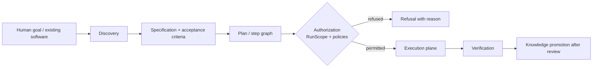
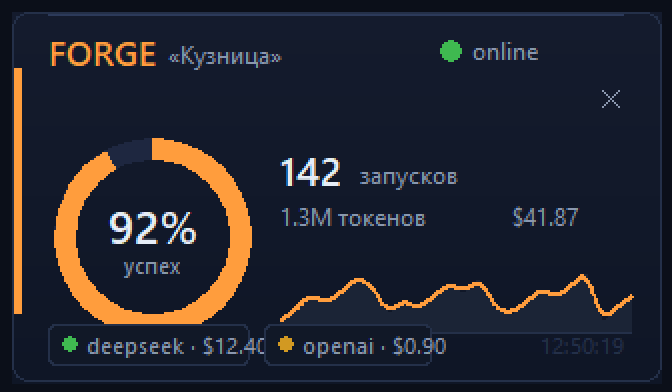

# Forge AI — User and Developer Guide

**English** | [Русская версия ниже](#forge-ai--руководство-пользователя-и-разработчика)

This guide is for someone who has just cloned the repository and wants to run it,
test it, diagnose it, and understand what is real today. Every command here was run
on this repository; nothing is aspirational. Where something is not implemented or
cannot be verified in this environment, it says so.

---

## 1. What Forge AI is

Forge AI is an **AI engineering factory**: it takes a human goal (or an existing
codebase, website or dataset) and drives it through discovery, specification,
planning, authorized execution and verification, then keeps what it learned as
reviewed knowledge. It is not a chat client, not a code-completion plugin and not a
model proxy. The engineering layer is the product; models are replaceable parts.

Three invariants explain most of the code:

* **Recommendation ≠ Permission** — a model may suggest an action; only an explicit
  authorization makes it permitted.
* **Permission ≠ Execution** — being permitted is not the same as having run.
* **Report ≠ Evidence** — a report about a run is not proof of the run.

## 2. Repository layout

| Path | What it holds |
|---|---|
| `app/` | the application: `api/`, `execution/`, `workflows/`, `agent_runtime/`, `understanding/`, `runtime/`, `tools/`, `desktop/`, … |
| `tests/` | the suite (`unittest`); ~2400 tests |
| `docs/` | architecture, specification, vision, roadmap, decisions, stage documents, `docs/audits/`, `docs/images/` |
| `scripts/` | `run_forge_pulse.cmd`, the desktop widget launcher |
| `requirements.txt` | runtime and development dependencies |
| `.forge/` | **local, gitignored** helper used on this host to run tests (see §6) |

## 3. How the system fits together



The authority chain is strict and one-directional: `RunScope` → `RunExecutor` →
`ExecutionCoordinator` → (`ApprovalPolicy`, `ExecutionPolicy`) →
`AuthorizedExecution` → `LocalExecutionAdapter`. A command runs only when it carries
an `AuthorizedExecution` token that can be minted solely inside the coordinator.
`EXACTLY_ONCE` is deliberately absent: the guarantee is at-most-once per attempt
while the journal is readable.

## 4. Environment requirements

* **Python 3.13** with the project virtual environment at `.venv` (this repository
  was exercised with the bundled `.venv`).
* **Windows**: process-tree termination uses a job object; the widget uses `tkinter`
  from the standard library. No third-party GUI dependency is required.
* **PostgreSQL + `asyncpg`**: *optional for everything documented here, required for
  the Platform database tests.* They are absent on this host, so those tests skip —
  see §9. Do not treat a skip as a pass.
* **`OPENAI_API_KEY`**: only one test uses it, and it skips without it. The test
  runtime is deliberately offline by default.

## 5. Install and run

```powershell
# from the repository root
python -m venv .venv                      # if .venv does not exist yet
.\.venv\Scripts\python.exe -m pip install -r requirements.txt
```

Start the API (loopback only; the app refuses a non-loopback bind):

```powershell
$env:FORGE_ENV='test'; $env:FORGE_API_HOST='127.0.0.1'; $env:FORGE_API_PORT='8005'
.\.venv\Scripts\python.exe -B -X utf8 -m app.api.main
```

Start the desktop widget (no console window):

```powershell
.\scripts\run_forge_pulse.cmd
```



That image is a real screen capture of the tkinter render with sample data, not a
mock-up.

## 6. Running the tests

On a fresh clone:

```powershell
.\.venv\Scripts\python.exe -B -X utf8 -m unittest discover -s tests -v
.\.venv\Scripts\python.exe -B -X utf8 -m unittest discover -s tests -p "test_artifact_provenance.py" -v
```

On the host where this repository was developed, `unittest` is invoked through a
local, gitignored helper:

```powershell
.\.venv\Scripts\python.exe -B -X utf8 .forge\run_confined.py discover -s tests -v
```

The helper exists because this sandbox denies writes into directories created with
mode `0o700` (which is what `tempfile.mkdtemp()` creates) and its
`tempfile.gettempdir()` falls back to the repository root. The helper only pins a
deterministic temp directory and an isolated `FORGE_RUN_STORE_ROOT`; it changes no
application or test code. Evidence produced through it is reported as *confined with
documented environment substitutions*, never as an unconfined run.

Static checks:

```powershell
.\.venv\Scripts\python.exe -B -X utf8 -m compileall -q app tests
git diff --check
```

Last recorded full run: `Ran 2359 tests in 155.120s` / `OK (skipped=36)`.

## 7. Configuration and secrets

* Configuration is read from the environment; `.env.example` documents the expected
  names. **Never commit a real `.env`**, a key, a token or a password.
* The API binds loopback by default and refuses a non-loopback bind; there is **no
  authentication** on the surface, so loopback plus refusal is the only control.
* Nothing in the test suite requires network access. A live provider call is not part
  of any documented flow.

## 8. Execution, verification and recovery

* **Artifact verification.** The state of each declared artifact target is snapshotted
  immediately before the child process is created, and compared with the state
  measured after the run. The check passes only when this attempt demonstrably created
  or changed the file; a file that was already there and did not change is reported as
  `ERROR` (`artifact_preexisting_and_unchanged`), not as success.
* **Restoring a saved run.** `resume` re-validates the saved record against the plan
  the attempt declared. A saved `SUCCEEDED` is accepted only with real execution
  evidence; otherwise it is downgraded to `UNKNOWN` and the attempt derives
  `INDETERMINATE` rather than claiming completion.
* **Damaged records.** A record that cannot be read is reported with its reason and
  never raises out of the reader; the recovery scan continues with the other records.

## 9. Diagnostics

| Symptom | Cause and what to do |
|---|---|
| `PermissionError` writing under `%TEMP%\...` | The sandbox denies writes into `0o700` directories. Use the confined runner (§6) or a writable temp root. |
| 32 tests skip with a message about `asyncpg` | Expected: no PostgreSQL driver or server here. The Platform database contract is unverified in this environment. |
| 3 tests skip about symlinks | The environment forbids creating symlinks. |
| 1 test skips about `OPENAI_API_KEY` | By design: the runtime is offline unless a key is provided. |
| The widget opens and closes immediately | Run it with the console interpreter (`.\.venv\Scripts\python.exe -m app.desktop.widget`) to see the traceback. |
| `module not found` for `app.*` | Run from the repository root, or use the launcher, which changes directory for you. |
| A GET request seems to change state | Known open defect (blocker #4): `GET /api/product/verification-plan` still writes durable state. |

## 10. Known limitations

* **No OS-level sandbox.** Path checks are a server-side contract boundary, not
  process isolation.
* **No authentication** on the API surface.
* **Platform persistence is unverified here** (no PostgreSQL).
* **No live model call has been performed**; only deterministic/mock providers are
  exercised.
* **The verification contract cannot express "verify a pre-existing state"**; such a
  check is reported as `ERROR`. Changing this is a contract change and is pending an
  owner decision.
* **Open blockers**: #3 second half (a damaged record can still be overwritten by
  `run()`) and #4 (GET routes mutating durable state). See
  [`audits/FINALIZATION_CHECKPOINT.md`](audits/FINALIZATION_CHECKPOINT.md).

## 11. Web console (verified running)

The repository ships a server-authoritative web console. It is plain HTML/CSS/JS
served by the API itself -- there is no frontend build step -- and it holds no
authority of its own: every value is computed by a route and rendered as reported.

```powershell
$env:FORGE_ENV='test'; $env:FORGE_API_HOST='127.0.0.1'; $env:FORGE_API_PORT='8005'
.\.venv\Scripts\python.exe -B -X utf8 -m app.api.main
# then open http://127.0.0.1:8005/
```

Measured on a running instance:

| Request | Result |
|---|---|
| `GET /` | `200`, 10 775 bytes, `text/html; charset=utf-8`, contains the project card and the server-authoritative banner |
| `GET /app.css` | `200`, 6 046 bytes, `text/css; charset=utf-8` |
| `GET /app.js` | `200`, 71 334 bytes, `text/javascript; charset=utf-8` |
| `GET /api/product/onboarding` | `200`, real payload: `{"project_id":"default","projects":[{"name":"Forge Main Workspace","path":"<repo>","status":"active"}],"stage":"INITIAL", ...}` |
| `GET /api/product/verification-plan` | `200`, 1 106 bytes of JSON |

A launcher wraps the same command with the safe defaults and prints the URL. It is
a `.cmd` on purpose: this host's PowerShell execution policy refuses to run an
unsigned `.ps1`, so a PowerShell launcher would not be a reproducible command, and
the policy is not lowered to make one work:

```powershell
scripts\run_dev_console.cmd 8011
```

The console calls the real product routes (`/api/product/onboarding`, `.../change-impact`,
`.../verification-plan`, `.../memory`, `.../graph`, `.../approvals/...`, `.../accept`,
`.../baseline`, `.../evidence-graph`, `.../goal`, `.../refresh`) -- the list is extracted
from `app/static/app.js`, not invented.

**Not captured:** a browser screenshot of this page. The only browser on this host is
Microsoft Edge, and its headless mode cannot start inside this sandbox -- it fails to
grant its own network-context sandbox under both the system temp directory and a
profile inside the repository (`Failed to grant sandbox access ... Отказано в доступе`).
Verification is therefore by HTTP response and payload inspection. The desktop
surfaces have a real capture: `docs/images/forge-pulse-widget.png`.

## 12. PostgreSQL (verified here, and in CI)

The Platform persistence contract -- row-level security, `FORCE` RLS, partial unique
indexes, composite foreign keys, role boundaries -- runs against a real server. Skipping
is not passing, so the tests were made to run:

Measured on this host: `Ran 328 tests in 2838.378s` / `OK` against PostgreSQL 17.11
on `127.0.0.1:5433` with `asyncpg 0.30.0`. The first real execution failed with
`role "forge_platform_app" does not exist`: the fixture granted the platform
memberships before the migrations that create those roles had run. Fixed in
`tests/persistence_fixture.py` (memberships are granted after `apply_migrations`),
and the whole Platform suite then passed.

**Correction of an earlier claim:** the "32 skips" were 32 class-level `setUpClass`
skips. Behind them stood **328 tests** that had never executed. They have now.

Two ways to run them.

**A. In CI (nothing to install locally).** `.github/workflows/platform-postgres.yml`
starts a `postgres:16` service container and runs `test_platform*.py` with a live
`FORGE_PLATFORM_TEST_DSN`, then `scripts/check_platform_roles.py`, which fails the job
unless both fixture logins are `NOSUPERUSER` and `NOBYPASSRLS`. A second, database-free
job runs the general suite (and the symlink tests that skip on Windows). Both jobs carry
a hard timeout: the first version of this workflow ran the whole suite beside the database
and GitHub reported *"the hosted runner lost communication with the server"* after more
than three hours, because the Platform tests create a database and apply the migrations
once per test class.

**B. Locally against a throwaway cluster.**

```powershell
# 1. a PostgreSQL distribution and the driver
#    here: %TEMP%\forge_pg\postgres-windows-x86_64.txz  and  asyncpg 0.30.0 already
#    present in the user site-packages (PyPI is unreachable from this host)
python -c "import tarfile,pathlib,os; d=pathlib.Path('.forge/pgsql'); d.mkdir(parents=True,exist_ok=True); tarfile.open(pathlib.Path(os.environ['LOCALAPPDATA'])/'Temp'/'forge_pg'/'postgres-windows-x86_64.txz','r:xz').extractall(d)"
# 2. initialise and start it on loopback (password kept in a file, never printed)
.\\scripts\\run_local_postgres.cmd          # see the script for the exact commands
# 3. run the contract
$env:FORGE_PLATFORM_TEST_DSN = 'postgresql://postgres:<pw from .forge/pg-pw.txt>@127.0.0.1:5433/postgres'
$env:FORGE_PLATFORM_TEST_APP_LOGIN_PASSWORD = 'persistence-test-login'
.\.venv\Scripts\python.exe -B -X utf8 .forge\run_confined.py discover -s tests -p "test_platform*.py" -v
```

The suite takes about 47 minutes locally, because every test class creates its own
database and applies all migrations.

## 13. Documentation map

| Document | Purpose |
|---|---|
| [`../README.md`](../README.md) | entry point and current state |
| [`ARCHITECTURE.md`](ARCHITECTURE.md) | how the code is built today |
| [`TECHNICAL_SPECIFICATION.md`](TECHNICAL_SPECIFICATION.md) | target architecture and constraints |
| [`FORGE_VISION.md`](FORGE_VISION.md) | product direction |
| [`ROADMAP.md`](ROADMAP.md) | seven stages, dependencies, exit criteria |
| [`SOURCE_OF_TRUTH.md`](SOURCE_OF_TRUTH.md) | verified current state and source authority |
| [`DECISIONS.md`](DECISIONS.md) | architectural decisions and rationale |
| [`audits/FINAL_HANDOFF_TO_CHATGPT.md`](audits/FINAL_HANDOFF_TO_CHATGPT.md) | independent-audit package |
| [`audits/FINALIZATION_CHECKPOINT.md`](audits/FINALIZATION_CHECKPOINT.md) | open blockers and next steps |

---
---

# Forge AI — Руководство пользователя и разработчика

Это руководство — для того, кто только что склонировал репозиторий и хочет
запустить систему, протестировать её, разобраться в сбоях и понять, что реально
работает сегодня. Каждая команда здесь выполнена на этом репозитории; ничего
«на будущее» в настоящем времени не описано. Где что-то не реализовано или не
проверяется в этом окружении — это сказано прямо.

## 1. Что такое Forge AI

Forge AI — **фабрика инженерных работ**: она берёт цель человека (или существующий
код, сайт, набор данных) и проводит её через исследование, спецификацию,
планирование, авторизованное исполнение и проверку, а затем сохраняет полученное
как прошедшее ревью знание. Это не чат, не плагин автодополнения кода и не прокси
к моделям: продукт — инженерный слой, модели — заменяемые детали.

Три инварианта объясняют большую часть кода:

* **Recommendation ≠ Permission** — модель может предложить действие; разрешённым
  его делает только явная авторизация.
* **Permission ≠ Execution** — «разрешено» не значит «выполнено».
* **Report ≠ Evidence** — отчёт о прогоне не является доказательством прогона.

## 2. Структура репозитория

| Путь | Что содержит |
|---|---|
| `app/` | приложение: `api/`, `execution/`, `workflows/`, `agent_runtime/`, `understanding/`, `runtime/`, `tools/`, `desktop/`, … |
| `tests/` | набор тестов (`unittest`), около 2400 тестов |
| `docs/` | архитектура, спецификация, vision, дорожная карта, решения, stage-документы, `docs/audits/`, `docs/images/` |
| `scripts/` | `run_forge_pulse.cmd` — запуск десктоп-виджета |
| `requirements.txt` | зависимости |
| `.forge/` | **локальный, в gitignore** помощник для запуска тестов на этой машине (см. §6) |

## 3. Как система связана

Цепочка авторизации строгая и однонаправленная: `RunScope` → `RunExecutor` →
`ExecutionCoordinator` → (`ApprovalPolicy`, `ExecutionPolicy`) →
`AuthorizedExecution` → `LocalExecutionAdapter`. Команда выполняется только при
наличии токена `AuthorizedExecution`, который может быть выпущен исключительно
внутри координатора. `EXACTLY_ONCE` сознательно отсутствует: гарантия —
at-most-once на попытку, пока журнал читаем.

## 4. Требования к окружению

* **Python 3.13** и виртуальное окружение `.venv` в корне проекта.
* **Windows**: завершение дерева процессов использует job object; виджет работает
  на `tkinter` из стандартной библиотеки — сторонних GUI-зависимостей нет.
* **PostgreSQL и `asyncpg`**: для всего описанного здесь не требуются, но нужны для
  тестов Platform. На этой машине их нет, поэтому эти тесты пропускаются — см. §9.
  Пропуск не является успехом.
* **`OPENAI_API_KEY`**: используется одним тестом, без ключа он пропускается.
  Тестовое окружение по умолчанию работает офлайн.

## 5. Установка и запуск

```powershell
python -m venv .venv
.\.venv\Scripts\python.exe -m pip install -r requirements.txt

# API (только loopback; привязка не к loopback отклоняется)
$env:FORGE_ENV='test'; $env:FORGE_API_HOST='127.0.0.1'; $env:FORGE_API_PORT='8005'
.\.venv\Scripts\python.exe -B -X utf8 -m app.api.main

# десктоп-виджет (без консольного окна)
.\scripts\run_forge_pulse.cmd
```

## 6. Тесты

```powershell
.\.venv\Scripts\python.exe -B -X utf8 -m unittest discover -s tests -v
.\.venv\Scripts\python.exe -B -X utf8 -m compileall -q app tests
git diff --check
```

На машине разработки используется локальный помощник
`.\.venv\Scripts\python.exe -B -X utf8 .forge\run_confined.py discover -s tests -v`:
песочница запрещает запись в каталоги, созданные с режимом `0o700`
(`tempfile.mkdtemp()` создаёт именно такие), а её `tempfile.gettempdir()`
скатывается к корню репозитория. Помощник задаёт детерминированный temp и
изолированный `FORGE_RUN_STORE_ROOT` и не меняет ни код приложения, ни тесты.
Последний полный прогон: `2359 тестов`, `OK (skipped=36)`.

## 7. Конфигурация и секреты

Конфигурация читается из переменных окружения; имена перечислены в `.env.example`.
**Никогда не коммитьте настоящий `.env`, ключи, токены и пароли.** Аутентификации на
API нет: привязка к loopback и отказ от не-loopback адресов — единственный контроль.

## 8. Исполнение, проверка и восстановление

* **Проверка артефакта.** Состояние каждой объявленной цели снимается
  непосредственно перед созданием дочернего процесса и сравнивается с состоянием
  после. Проверка проходит, только если файл действительно создан или изменён этой
  попыткой; файл, существовавший до и не изменившийся, сообщается как `ERROR`
  (`artifact_preexisting_and_unchanged`), а не как успех.
* **Восстановление.** `resume` перепроверяет сохранённую запись против
  объявленного плана. Сохранённый `SUCCEEDED` принимается только при наличии
  реальных свидетельств исполнения; иначе он понижается до `UNKNOWN`, и попытка
  выводит `INDETERMINATE`, а не выдаёт завершение.
* **Повреждённые записи.** Нечитаемая запись сообщается с причиной и никогда не
  выбрасывает исключение из читателя; recovery-скан продолжает работу с остальными.

## 9. Диагностика

| Симптом | Причина и что делать |
|---|---|
| `PermissionError` при записи в `%TEMP%` | Песочница запрещает запись в каталоги `0o700`. Используйте локальный раннер (§6) или доступный temp. |
| Тесты Platform пропускаются с упоминанием `asyncpg` | Раньше это было ожидаемо (нет драйвера и сервера). Теперь контракт проверен: `Ran 328 tests` / `OK` против настоящего PostgreSQL — см. §12. |
| 3 теста пропускаются из-за symlink | Среда запрещает создание символических ссылок. |
| 1 тест пропускается без `OPENAI_API_KEY` | Так задумано: окружение офлайн. |
| Виджет сразу закрывается | Запустите через консольный интерпретатор (`.\.venv\Scripts\python.exe -m app.desktop.widget`) и посмотрите трейсбек. |
| `module not found` для `app.*` | Запускайте из корня репозитория или через лаунчер, который сам меняет каталог. |
| GET-запрос как будто меняет состояние | Известный открытый дефект (блокер №4): `GET /api/product/verification-plan` пишет durable state. |

## 10. Известные ограничения

* **Нет OS-песочницы**: проверки путей — это контрактная граница сервера, а не
  изоляция процесса.
* **Нет аутентификации** на API.
* **Platform проверен** — 328 тестов против настоящего PostgreSQL (§12); в CI тот же контракт выполняет отдельная задача на `postgres:16`.
* **Живой вызов модели не выполнялся**; работают детерминированные/mock-провайдеры.
* **Контракт проверки не умеет «проверить ранее существующее состояние»**: такая
  проверка сообщается как `ERROR`. Это изменение контракта и ждёт решения владельца.
* **Открытые блокеры**: №3 (вторая половина — повреждённая запись всё ещё может быть
  затронута при `run()`) и №4 (GET-мутации). См.
  [`audits/FINALIZATION_CHECKPOINT.md`](audits/FINALIZATION_CHECKPOINT.md).

## 11. Веб-консоль (проверена на запущенном приложении)

В репозитории есть серверно-авторитетная веб-консоль: обычные HTML/CSS/JS, которые
отдаёт сам API — шага сборки фронтенда нет. Собственной власти у страницы нет: каждое
значение вычислено маршрутом и показано так, как сообщено сервером.

```powershell
$env:FORGE_ENV='test'; $env:FORGE_API_HOST='127.0.0.1'; $env:FORGE_API_PORT='8005'
.\.venv\Scripts\python.exe -B -X utf8 -m app.api.main
# затем откройте http://127.0.0.1:8005/
```

Измерено на запущенном экземпляре:

| Запрос | Результат |
|---|---|
| `GET /` | `200`, 10 775 байт, `text/html; charset=utf-8`, содержит карточку проекта и баннер о серверном авторитете |
| `GET /app.css` | `200`, 6 046 байт, `text/css; charset=utf-8` |
| `GET /app.js` | `200`, 71 334 байта, `text/javascript; charset=utf-8` |
| `GET /api/product/onboarding` | `200`, реальные данные: `{"project_id":"default","projects":[{"name":"Forge Main Workspace","path":"<repo>","status":"active"}],"stage":"INITIAL", ...}` |
| `GET /api/product/verification-plan` | `200`, 1 106 байт JSON |

Ту же команду с безопасными настройками и печатью адреса запускает лаунчер. Он
сделан `.cmd` намеренно: политика выполнения PowerShell на этой машине отказывается
запускать неподписанный `.ps1`, поэтому PowerShell-лаунчер не был бы воспроизводимой
командой, а понижать политику ради этого нельзя:

```powershell
scripts\run_dev_console.cmd 8011
```

Консоль обращается к настоящим продуктовым маршрутам (`/api/product/onboarding`,
`.../change-impact`, `.../verification-plan`, `.../memory`, `.../graph`,
`.../approvals/...`, `.../accept`, `.../baseline`, `.../evidence-graph`, `.../goal`,
`.../refresh`) — список извлечён из `app/static/app.js`, а не выдуман.

**Чего нет:** скриншота этой страницы из браузера. Единственный браузер на машине —
Microsoft Edge, и его headless-режим не запускается внутри этой песочницы: он не может
выдать своему сетевому контексту sandbox-доступ ни в системном temp, ни в профиле
внутри репозитория (`Failed to grant sandbox access ... Отказано в доступе`). Поэтому
проверка выполнена по HTTP-ответам и содержимому. У десктопных поверхностей настоящий
снимок есть: `docs/images/forge-pulse-widget.png`.

## 12. PostgreSQL (проверено здесь и в CI)

Контракт Platform — row-level security, `FORCE` RLS, частичные уникальные индексы,
составные внешние ключи, границы ролей — выполняется против настоящего сервера.
Пропуск не равен успеху, поэтому тесты заставили выполняться:

Measured on this host: `Ran 328 tests in 2838.378s` / `OK` against PostgreSQL 17.11
on `127.0.0.1:5433` with `asyncpg 0.30.0`. The first real execution failed with
`role "forge_platform_app" does not exist`: the fixture granted the platform
memberships before the migrations that create those roles had run. Fixed in
`tests/persistence_fixture.py` (memberships are granted after `apply_migrations`),
and the whole Platform suite then passed.

**Correction of an earlier claim:** the "32 skips" were 32 class-level `setUpClass`
skips. Behind them stood **328 tests** that had never executed. They have now.

Два способа запуска.

**A. В CI (локально ставить нечего).** `.github/workflows/platform-postgres.yml`
поднимает сервис-контейнер `postgres:16`, прогоняет `test_platform*.py` с живым
`FORGE_PLATFORM_TEST_DSN`, затем `scripts/check_platform_roles.py`, который валит job,
если хотя бы один логин фикстуры окажется суперпользователем или получит `BYPASSRLS`.
Вторая задача без базы прогоняет общий набор (и symlink-тесты, которые на Windows
пропускаются). У обеих задач жёсткий таймаут: первая версия workflow гоняла весь набор
рядом с базой, и GitHub сообщил *«the hosted runner lost communication with the
server»* после более чем трёх часов — потому что Platform-тесты создают базу и
применяют миграции на каждый класс тестов.

**B. Локально на одноразовом кластере.** Дистрибутив PostgreSQL и драйвер берутся из
того, что уже есть на машине (`%TEMP%\forge_pg\postgres-windows-x86_64.txz` и
`asyncpg 0.30.0` в пользовательском site-packages; PyPI отсюда недоступен), кластер
поднимается на `127.0.0.1:5433`, пароль хранится в файле и не печатается. Команды —
в английской части выше. Прогон занимает около 47 минут.

## 13. Карта документации

См. таблицу в английской части §13 — состав документов и их назначение совпадают.
