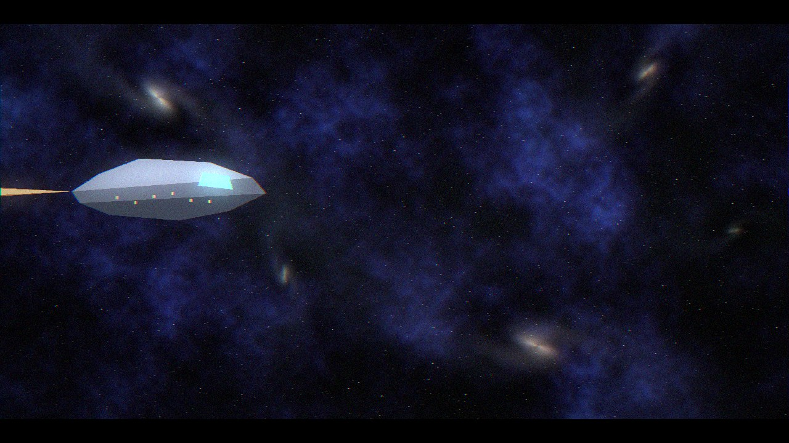

# FORGE AI — Visual Rebirth

**Stage:** first delivery (design system, Overview, authorization).
**Status:** prototype running, real screenshots taken, awaiting approval before other screens
are migrated.
**Checkpoint before this work:** git tag `checkpoint-before-visual-rebirth` → `9f9daac`.
The previous working version still starts: `python -m app.desktop`.

---

## 1. What was delivered

| Item | Where | Evidence |
|---|---|---|
| Design system (tokens, type scale, spacing, radii, motion) | `ui/src/design/tokens.css` | palette: Space Navy, Graphite, Electric Violet, Cyan, Ice White |
| Component library (buttons with states, cards, KPI cards, badges, status dots, fields, meters, sparklines, nav rail, top bar, tables) | `ui/src/design/components.css`, `ui/src/components/` | no widget-library defaults anywhere |
| Custom stroke icon set and product mark | `ui/src/components/Icons.tsx` | inline SVG, no icon package |
| **Overview screen** | `ui/src/screens/Overview.tsx` | `docs/images/ui-overview.png` |
| **Authorization screen** in the same system | `ui/src/screens/Auth.tsx` | `docs/images/ui-auth.png` |
| Bilingual shell (RU/EN, everything re-labels) | `ui/src/i18n.ts` | `docs/images/ui-overview-en.png` |
| Real backend wiring | `ui/src/api/client.ts` | endpoint list verified by probe, below |
| Launcher and review server | `scripts/forge-command-center.cmd`, `tools/ui_preview_server.py` | opens the shell in a WebView2 window |

### The numbers on the screen are real

Probed against the running Core, not assumed:

```
/api/health             404   (the first draft guessed this path; it does not exist)
/api/status             200   core=connected api=connected provider_status=DEGRADED
                              providers_ready=0 providers_total=7 active_project=default
/api/dashboard          200   providers[] with account_status and balance_display
/api/product/runs       200   project_id=default runs=[] total_recorded=0
/api/product/onboarding 200   projects[] → "Forge Main Workspace", path, status
```

The Overview reads those four endpoints, shows what came back, and prints a **Data sources**
panel listing each endpoint with what it answered — so every figure on the page is traceable.
Where the backend has nothing (`runs` is empty), the screen says "Запусков пока нет" instead
of inventing activity. The invented budget meters from the first draft were deleted: they were
backed by nothing. Status words (`CONNECTED`, `DEGRADED`, `NOT_CHECKED`) stay untranslated,
because they are literals, like `PASSED` and `UNKNOWN` elsewhere in Forge.

---

## 2. Interface architecture: decision and the measurements behind it

### Measured on this machine

| Capability | Result |
|---|---|
| WebView2 runtime | **present**, `154.0.4258.62` |
| Microsoft Edge | `C:\Program Files (x86)\Microsoft\Edge\Application\msedge.exe` |
| Headless screenshots | **work** (`--headless=new --screenshot`) |
| Node.js | `v24.21.0`, npm registry **reachable** |
| Rust / cargo | **absent** |
| ffmpeg | **absent** anywhere on the machine |

### Decision

**React + TypeScript + Vite**, built to static assets, served same-origin next to the existing
FastAPI Core (the review server proxies `/api`), displayed in an **Edge WebView2 window**
(`msedge --app=…`), which gives a chromeless native-feeling window with no install.

**Measured build size:** `index.js` 164 KB (gzip **53 KB**), `index.css` 13 KB (gzip **3.5 KB**).
The whole interface is ~57 KB over the wire; `node_modules` is development-only.

### Rejected, with reasons

| Option | Why not |
|---|---|
| **Tauri** | needs a Rust toolchain: **cargo is absent**, and installing one is a ~1.5 GB download requiring approval. The frontend above is portable, so Tauri can be adopted later without rewriting the interface. |
| **Electron** | no Rust, but ~200 MB per application and a slower cold start; WebView2 is already present and is the same engine. |
| **Keeping Tkinter** | cannot express the required design (no CSS: no gradients, blur, shadows, custom states, smooth transitions). It stays as the legacy path, not as the target. |

### Risks and their mitigation

| Risk | Mitigation |
|---|---|
| Depends on Edge being installed | WebView2 runtime is the supported long-term host; a small native host can replace `--app` later with no frontend change. |
| Browser profile pollution | the launcher passes `--user-data-dir=.forge\webview-profile`, so the shell has its own profile. |
| CORS between shell and Core | avoided entirely: the review server serves the build and proxies `/api` to `127.0.0.1:8011`, so the page is same-origin. No backend change was needed. |
| Regression in the product | the Python Core, Platform, Fabric and Registry are **untouched**; the tkinter application still starts; the full test suite result is recorded in the report. |

### Migration plan (after approval of this screen)

1. Approve or correct the design system and Overview.
2. Port the remaining sections one at a time — Projects, Agents, Models, Runs, Tools,
   Usage & Costs, Settings, Help — each as a separate reviewable delivery.
3. Wire authorization to the existing account authority (`app/desktop/accounts.py`) so the
   code-hash, expiry and attempt limits stay exactly as they are; no new access path.
4. Only then make the web shell the default launcher and retire the tkinter shell.
5. Remove the procedural tkinter introduction and its tests in that final step, together with
   the legacy shell — not before, so the working version stays runnable.

### Constraints explicitly respected

* **No SQL, migration, RLS, Core authorization or protected file was touched.** This delivery
  adds files under `ui/`, plus `tools/ui_preview_server.py` and one launcher script.
* **Recommendation ≠ Permission, Permission ≠ Execution, Report ≠ Evidence** — untouched; the
  interface only reads.
* **No demonstration data.** See the Data sources panel and the deleted budget meters.
* **The previous version still runs.**

---

## 3. The video introduction: what is actually available

The procedural renderer (`tools/render_intro.py`) produced the space frame below and is now
**out of the product path** — it is not shown at launch by the new shell. The interior frame
showed exactly why procedural drawing is the wrong tool for a cinematic: flat figures, hard
edges, no materials.



### Real production options, with cost, licence and limits

| Option | Cost | Licence | Limits | Needs approval |
|---|---|---|---|---|
| **Blender** (3D, offline) | free | GPL | ~300 MB download; the cinematic quality depends on modelling and lighting work, which is real production time, not a script | install approval |
| **ffmpeg** (encoding only) | free | LGPL/GPL | ~100 MB; **absent today**; without it no MP4 can be produced — animated WebP or a hand-written MJPEG AVI are the only offline containers | install approval |
| **DaVinci Resolve** | free tier | proprietary EULA | ~3 GB; editing, colour and sound, **not** 3D generation | install approval |
| **AI video services** (Runway, Kling, Luma, Veo, Sora-class) | paid: typically a monthly plan or credit packs, tens of USD per month | proprietary, commercial terms vary per plan and per model | need the owner's account, payment method and upload of prompts; quality is the highest and the effort the lowest | **account, payment and explicit approval** |
| **Local AI video** (Stable Video Diffusion, AnimateDiff) | free | various | multi-GB model downloads and a capable GPU; the GPU here is unverified | download approval |

**Recommendation.** For the 5–8 second everyday intro, a paid AI video service gives the
required quality with the least production risk — but it needs your account and your payment,
so it cannot be started by an agent alone. The free path is Blender plus ffmpeg: no licence
cost, full control, and it can be produced entirely on this machine once the tools are
installed. Until one of those is approved, the product launches **without** any introduction
rather than with a placeholder.

---

## 4. Notes for the next agent

* **Never round-trip a UTF-8 source file through PowerShell text cmdlets.** `Get-Content -Raw`
  decodes with the system ANSI code page, so a later `WriteAllText` re-encodes broken text.
  This corrupted the slogan on the authorization screen once; it is fixed and the rule is now
  part of this file.
* The frontend is built with the bundled Node/pnpm. The bundled pnpm refuses to run dependency
  build scripts (supply-chain policy), so the build is invoked directly:
  `node node_modules/typescript/bin/tsc --noEmit -p tsconfig.json` and
  `node node_modules/vite/bin/vite.js build`.
* Screenshots are taken with headless Edge against the review server, so no desktop capture and
  no DPI problems are involved.
